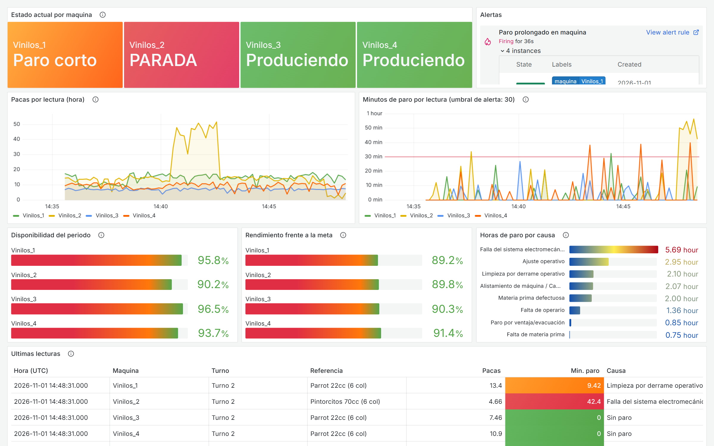
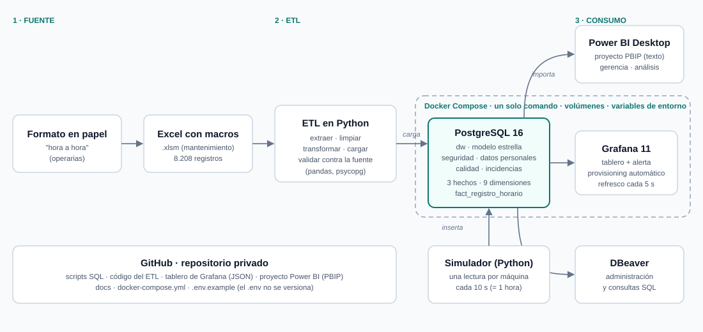

# BI Vinilos y Témperas: producción y paros de las líneas de envasado

Proyecto final de **Inteligencia de Negocios**. Integra los registros históricos de producción y paros de las líneas de envasado **Vinilos_1 a Vinilos_4** (enero de 2022 a marzo de 2025) en un modelo dimensional sobre PostgreSQL y los consume desde dos tableros complementarios:

- **Power BI**: análisis gerencial (OEE, tendencias, Pareto de causas de paro, comparativo anual).
- **Grafana**: monitoreo casi en tiempo real con una alerta de paro prolongado, para supervisores y mantenimiento.

**Integrantes:** Andrés Felipe Asprilla Pedroza y Jorge Andrés Grisales



## Qué se logró

| | |
|---|---|
| **Datos** | 8.208 registros del Excel limpiados y cargados: 5.138 jornadas y 16.482 eventos de paro. Los totales **cuadran con la fuente** (informe automático en [docs/validacion_etl.md](docs/validacion_etl.md)) |
| **Modelo** | Esquema en estrella: 3 tablas de hechos, 9 dimensiones, jerarquía de paros de 4 niveles |
| **Indicadores** | OEE y sus componentes, Pareto, MTTR, MTBF y comparativos contra el año anterior |
| **Monitoreo** | Tablero de Grafana con simulación hora a hora y alerta que se dispara en menos de un minuto |
| **Despliegue** | Todo lo que es servidor corre en Docker con un solo comando, con datos en volúmenes y configuración automática |
| **Seguridad** | Nombres de operarios seudonimizados y aparte; los tableros leen con un usuario de solo lectura |

Hallazgos y recomendaciones para la gerencia: [docs/resumen_ejecutivo.md](docs/resumen_ejecutivo.md). Informe completo en PDF: [docs/informe/](docs/informe/).

## Arquitectura



## Cómo recorrer este proyecto

| Si tienes… | Haz esto |
|---|---|
| **5 minutos** | Lee este README, mira las capturas de arriba y el [resumen ejecutivo](docs/resumen_ejecutivo.md) |
| **15 minutos** | Añade el [diagnóstico de la fuente](docs/diagnostico/diagnostico_fuente.md), el [modelo dimensional](docs/modelo_dimensional.md) y la [arquitectura](docs/arquitectura.md) |
| **Ganas de verlo funcionando** | Sigue el *Inicio rápido* de abajo: unos minutos y un solo comando |
| **Interés en entenderlo todo** | Recorre el [índice de documentación](docs/README.md). Si un término no te suena (OEE, MTTR, esquema en estrella…), está en el [glosario](docs/glosario.md) |

## Inicio rápido

**Requisitos:** Git, Docker Desktop (en marcha) y Python 3.11 o superior. Power BI Desktop solo si se quiere abrir el tablero analítico.

```powershell
git clone https://github.com/ISFLOWAAA/bi-vinilos.git
cd bi-vinilos
.\iniciar.ps1            # Windows (PowerShell)
```

En Linux, macOS o Git Bash: `./iniciar.sh`.

El script hace todo: crea el archivo `.env` con contraseñas aleatorias, levanta PostgreSQL y Grafana, prepara Python, carga el Excel y valida que los totales cuadren. Tarda unos minutos la primera vez (descarga las imágenes de Docker). Al terminar muestra las direcciones y dónde están las credenciales.

Después:

| Quiero… | Hago |
|---|---|
| Ver el tablero de Grafana | Abrir `http://localhost:<GRAFANA_PORT>` (puerto y credenciales en el `.env`). Está en la carpeta **BI Vinilos** |
| Ver datos moviéndose | `.venv\Scripts\python simulacion\simular.py` |
| Ver la alerta saltar | En otra terminal: `.venv\Scripts\python simulacion\simular.py --provocar Vinilos_2` (y `--normalizar` para quitarla) |
| Abrir el tablero de Power BI | Abrir `powerbi/BI_Vinilos.pbip` y seguir [powerbi/README.md](powerbi/README.md) |
| Consultar la base | DBeaver o `psql` con los datos de conexión de [docs/configuracion.md](docs/configuracion.md) |
| Apagar todo | `docker compose down` (conserva los datos) |

<details>
<summary><b>Paso a paso manual, sin el script</b></summary>

1. Copiar `.env.example` como `.env` y definir las tres contraseñas. Si los puertos 5432 o 3000 están ocupados en tu equipo, cambia `POSTGRES_PORT` y `GRAFANA_PORT`.
2. `docker compose up -d --wait`
3. `python -m venv .venv`
4. `.venv\Scripts\python -m pip install -r etl\requirements.txt` (en Linux o macOS: `.venv/bin/python`)
5. `.venv\Scripts\python etl\main.py` (debe terminar con `TODO CUADRA`)

</details>

Para configuración, puertos, cambio de contraseñas y **solución de problemas**: [docs/configuracion.md](docs/configuracion.md).

## Qué hay en el repositorio

```
bi-vinilos/
├── iniciar.ps1 · iniciar.sh   Levantan todo con un comando
├── docker-compose.yml         PostgreSQL y Grafana
├── .env.example               Plantilla de configuración (el .env real no se sube)
├── data/raw/                  Excel fuente original
├── etl/                       ETL en Python: extraer, limpiar, transformar, cargar, validar (con pruebas)
├── sql/
│   ├── init/                  DDL, datos fijos, vistas y usuario de solo lectura (se ejecutan solos)
│   └── consultas/             10 consultas analíticas con funciones de ventana
├── simulacion/                Simulador de lecturas hora a hora
├── grafana/                   Tablero exportado (JSON) y provisioning automático (fuente de datos, alerta)
├── powerbi/                   Proyecto de Power BI en formato PBIP (modelo semántico y 3 páginas)
└── docs/                      Documentación, capturas e informe final en PDF
```

| Carpeta | Más información |
|---|---|
| `etl/` | [etl/README.md](etl/README.md): por qué Python, reglas de limpieza y cómo ejecutarlo |
| `simulacion/` | [simulacion/README.md](simulacion/README.md): qué simula y guion para la demostración |
| `grafana/` | [grafana/README.md](grafana/README.md): paneles, variables y la alerta |
| `powerbi/` | [powerbi/README.md](powerbi/README.md): cómo abrirlo, modelo, medidas DAX y páginas |
| `sql/` | [sql/README.md](sql/README.md): qué hace cada script de `init/` y las 10 consultas analíticas |
| `data/` | [data/README.md](data/README.md): la fuente original y cómo se usa |
| `docs/` | [docs/README.md](docs/README.md): índice de lectura de toda la documentación |

## Documentación

Índice con una guía de lectura: [docs/README.md](docs/README.md). Términos técnicos explicados: [docs/glosario.md](docs/glosario.md).

| Documento | Contenido |
|---|---|
| [docs/resumen_ejecutivo.md](docs/resumen_ejecutivo.md) | Hallazgos y recomendaciones para la gerencia |
| [docs/diagnostico/diagnostico_fuente.md](docs/diagnostico/diagnostico_fuente.md) | Estructura del Excel, problemas de calidad y limitaciones del reporte actual |
| [docs/catalogo_indicadores.md](docs/catalogo_indicadores.md) | Usuarios, preguntas de negocio, supuestos e indicadores (incluido el OEE) |
| [docs/modelo_dimensional.md](docs/modelo_dimensional.md) | Modelo en estrella, granularidad, jerarquía de paros, matriz de bus |
| [docs/diccionario_datos.md](docs/diccionario_datos.md) | Columnas, tipos, llaves, origen y reglas de cada tabla |
| [docs/validacion_etl.md](docs/validacion_etl.md) | Reglas de limpieza con conteos antes y después, y cuadre de totales |
| [docs/base_de_datos.md](docs/base_de_datos.md) | Restricciones e índices justificados y las 10 consultas analíticas |
| [docs/arquitectura.md](docs/arquitectura.md) | Flujo de datos y decisiones de diseño |
| [docs/comparativo_power_bi_grafana.md](docs/comparativo_power_bi_grafana.md) | Qué resuelve cada herramienta, para quién y por qué no se intercambian |
| [docs/evolucion_plc_scada.md](docs/evolucion_plc_scada.md) | Cómo evolucionaría la solución con datos directos de PLC o SCADA |
| [docs/seguridad_datos_personales.md](docs/seguridad_datos_personales.md) | Tratamiento de datos personales y seguridad de acceso |
| [docs/configuracion.md](docs/configuracion.md) | Variables, puertos, conexiones, cambio de contraseñas y solución de problemas |
| [docs/P-MTO-22_Registro_paros_de_produccion.pdf](docs/P-MTO-22_Registro_paros_de_produccion.pdf) | Procedimiento original de registro de paros |
| [CONTRIBUTING.md](CONTRIBUTING.md) | Cómo colaborar en el repositorio |

## Decisiones de diseño en breve

- **Python para el ETL:** hay que despivotar 18 pares de columnas código/horas y normalizar texto sucio; es largo y frágil en SQL o Power Query, y en Python queda reproducible, con pruebas y en Git.
- **Estrella y no copo de nieve:** menos uniones, consultas simples y jerarquías de un solo nivel por dimensión, ideales para el drill-down de Power BI.
- **Power BI en formato PBIP:** son carpetas de texto que Git puede comparar y fusionar; un `.pbix` es un binario que no.
- **Power BI y Grafana leen la misma base:** así las cifras coinciden y el Excel deja de ser la fuente de verdad.
- **Grafana sin configuración manual:** fuente de datos, tablero y alerta se cargan desde archivos al iniciar.

## Limitaciones conocidas

- La **velocidad de referencia** del OEE es un percentil 90 del histórico (la fuente no guarda la meta), por lo que el OEE puede superar 100 % en algún mes.
- La **calidad** del OEE es una aproximación (horas de reproceso y materia prima defectuosa); la fuente no registra producto no conforme.
- Los datos de **2025 llegan solo hasta marzo**.

Detalle en [docs/catalogo_indicadores.md](docs/catalogo_indicadores.md) y [docs/diagnostico/diagnostico_fuente.md](docs/diagnostico/diagnostico_fuente.md).

## Tecnologías

Python (pandas, psycopg) · PostgreSQL 16 · Docker Compose · Grafana 11 · Power BI Desktop · DBeaver · Git y GitHub
