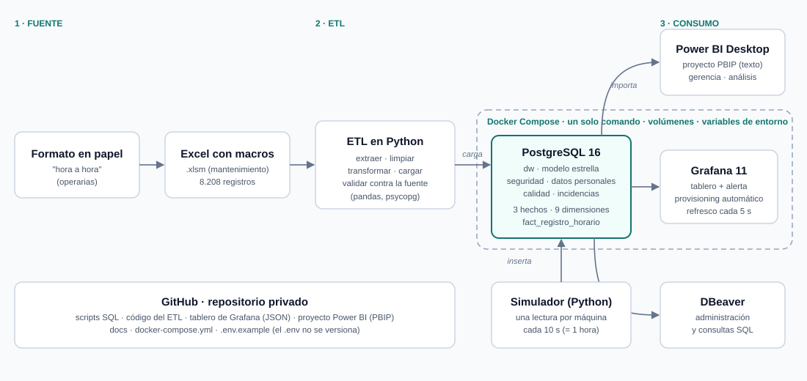

# Arquitectura de la solución

## Flujo de datos

| Paso | Qué ocurre | Herramienta |
|---|---|---|
| 1. Captura | Las operarias llenan el formato "hora a hora" en papel; mantenimiento lo transcribe a un Excel con macros. | Papel y Excel (situación actual, sin cambios) |
| 2. ETL | Se lee el Excel, se limpia (duplicados, turnos, subcódigos, referencias), se despivotan los 18 códigos de paro y se carga al modelo. Al final se cuadran los totales contra la fuente. | Python (pandas, psycopg) |
| 3. Almacén | Modelo en estrella en el esquema `dw`; los nombres de operarios en `seguridad`; las correcciones del ETL en `calidad`. | PostgreSQL 16 en Docker |
| 4. Capa analítica | Importa el modelo, calcula OEE, Pareto y comparativos de tiempo para la gerencia. | Power BI Desktop |
| 5. Capa operativa | Lee `fact_registro_horario` cada 5 s, muestra el estado de cada máquina y dispara la alerta. | Grafana 11 en Docker |
| 6. Simulación | Emula las lecturas hora a hora de las líneas para demostrar el tablero y la alerta. | Python |

## Decisiones de diseño

- **Power BI y Grafana leen la misma base, no el Excel.** Así las cifras coinciden entre ambos y el Excel deja de ser la fuente de verdad.
- **Todo lo que es servidor va en contenedores** (base y Grafana) para que se levante con `docker compose up -d --wait`, con datos en volúmenes y credenciales en variables de entorno. Power BI y DBeaver corren en el equipo anfitrión y se conectan a los puertos publicados.
- **Grafana no se configura a mano:** la fuente de datos, el tablero y la alerta se cargan desde archivos al iniciar (*provisioning*).
- **Todo es reproducible desde cero** y está versionado: no existe un paso que dependa de clics.
