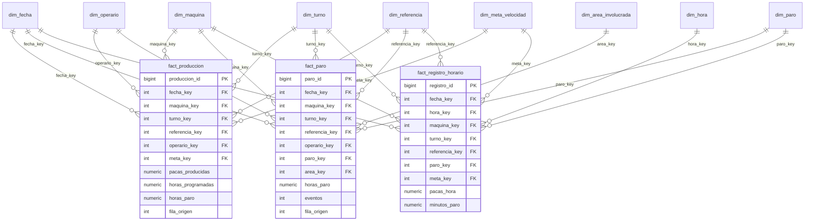

# Modelo dimensional

## 1. Decisión: esquema en estrella

Se usa un **esquema en estrella** con tablas de hechos y dimensiones desnormalizadas, en PostgreSQL.

| Alternativa | Por qué no |
|---|---|
| Una sola tabla ancha (como el Excel) | Es el problema actual: 58 columnas, 18 pares código/horas y sin llaves. No permite jerarquías ni cruces limpios. |
| Copo de nieve (snowflake) | Normaliza las dimensiones y agrega uniones. Con 4 máquinas, 52 referencias y 18 códigos no ahorra espacio y hace más lentas las consultas de Grafana y más confuso el modelo semántico de Power BI. |
| **Estrella** | Menos uniones, consultas simples, jerarquías de un solo nivel por dimensión (ideal para el drill-down de Power BI) y buen rendimiento en agregaciones. |

## 2. Tablas de hechos y su granularidad

| Tabla | **Granularidad (una fila es…)** | Medidas | Origen |
|---|---|---|---|
| `fact_produccion` | Una **jornada**: una máquina, un día, un turno, un operario y una referencia. Son las filas de `Base De Datos` con producción (5.160). | `pacas_producidas`, `horas_programadas`, `horas_paro`, `horas_productivas` (derivada) | `Base De Datos` |
| `fact_paro` | Un **evento de paro**: una jornada y un código de paro (y subcódigo, si lo tiene) con horas mayores que cero. Resulta de despivotar las 18 columnas "Código N en horas". | `horas_paro`, `minutos_paro`, `eventos` (siempre 1, para contar fallas) | `Base De Datos` y `Base de datos de Sub codigos` |
| `fact_registro_horario` | **Una hora de una máquina** en el tiempo casi real. Es la tabla que alimenta la simulación y Grafana. | `pacas_hora`, `minutos_paro` | Script de simulación (sin histórico) |

Reglas de granularidad:
- Las **filas de subcódigo sin producción no son jornadas**: solo generan filas en `fact_paro`.
- Las medidas son **aditivas** (suman por cualquier dimensión). Los porcentajes y el OEE **no se guardan**: se calculan en SQL y en DAX para que los totales sean correctos.
- La llave natural (fecha, máquina, operario, referencia, turno) se repite en 5.377 filas, así que cada hecho lleva una **llave sustituta** y el número de fila de origen para poder auditar.

## 3. Dimensiones

| Dimensión | Llave | Atributos | Jerarquía | Origen |
|---|---|---|---|---|
| **`dim_fecha`** (construida por nosotros) | `fecha_key` (aaaammdd) | fecha, año, trimestre, mes, nombre del mes, semana ISO, día del mes, día de la semana, es fin de semana, año-mes | Año → Trimestre → Mes → Día | Calendario generado (2022-01-01 en adelante), no viene del Excel |
| **`dim_hora`** (construida) | `hora_key` (0–23) | hora, franja (madrugada, mañana, tarde, noche) | Franja → Hora | Generada |
| **`dim_maquina`** | `maquina_key` | nombre (Vinilos_1 a Vinilos_4), línea de producto | Línea → Máquina | `Maquina` |
| **`dim_turno`** (construida) | `turno_key` | nombre limpio, hora de inicio, hora de fin, duración en horas | Tipo de turno → Turno | `Turno`, con catálogo de equivalencias (8 valores crudos → 7 turnos) |
| **`dim_referencia`** | `referencia_key` | nombre original, producto, contenido en cc, número de colores | Producto → Referencia | `Referencia`, separando por ejemplo "Parchesitos 22cc (6 col)" |
| **`dim_operario`** | `operario_key` | código seudónimo (OP-001), activo | — | `Operario` (ver privacidad) |
| **`dim_paro`** | `paro_key` | área de impacto, código y nombre, es programado, subsistema (código y nombre), detalle (código y nombre) | Área de impacto → Código → Subsistema → Detalle | `TABLA CODIGOS` y equivalencias |
| **`dim_area_involucrada`** | `area_key` | Operarios, Personal de mantenimiento, No especificado | — | `Área involucrada en subcódigo` |
| **`dim_meta_velocidad`** | `meta_key` | máquina, referencia, pacas por hora de referencia, vigente desde, vigente hasta, es vigente | — | Calculada del histórico (supuesto S3) |

Todas las dimensiones tienen un miembro **"Desconocido" (llave −1)** para los nulos de la fuente (3.721 operarios, 3.874 referencias y 3.912 turnos), de modo que ningún hecho se pierde en una unión.

### Cómo se modela la jerarquía de los paros

Los paros se guardan en **una sola dimensión desnormalizada, `dim_paro`, con una fila por hoja de la jerarquía** y cuatro niveles como columnas:

`Área de impacto → Código de paro → Subsistema → Detalle`

Ejemplo: Mantenimiento → [01] Falla electromecánica → 1.2 Sistema de dosificación → 1.2.B Ajuste de sensor.

Por qué así:
- **La jerarquía es irregular**: la fuente solo captura subcódigos para los códigos 01, 03 y 05, y solo el 01 tiene un tercer nivel. Los códigos sin subcódigo reciben una fila con "Sin subcódigo" en los niveles inferiores, así la profundidad es fija.
- **Cada hecho apunta al nivel más fino disponible**, y los totales por código, subsistema o área salen sumando hacia arriba, lo que habilita el **drill-down** y el **Pareto** en Power BI sin lógica extra.
- **Se descarta la tabla padre-hijo** (con `PATH` en DAX) porque la profundidad es conocida y fija; evita fórmulas más complejas para un beneficio nulo.
- **El área de impacto** (Mantenimiento, Producción, Calidad, Almacén, Paro programado) viene de la propia empresa y responde "¿quién puede actuar sobre este paro?".
- `es_programado` (supuesto S5) vive aquí, así que separar paro programado de no programado es un simple filtro.

## 4. Matriz de bus

| Proceso de negocio | fecha | hora | máquina | turno | referencia | operario | paro | área involucrada | meta velocidad |
|---|:-:|:-:|:-:|:-:|:-:|:-:|:-:|:-:|:-:|
| Producción por jornada (`fact_produccion`) | ✔ | | ✔ | ✔ | ✔ | ✔ | | | ✔ |
| Paros de producción (`fact_paro`) | ✔ | | ✔ | ✔ | ✔ | ✔ | ✔ | ✔ | |
| Registro horario casi en tiempo real (`fact_registro_horario`) | ✔ | ✔ | ✔ | ✔ | ✔ | | ✔ | | ✔ |

Las dimensiones compartidas (**fecha, máquina, turno, referencia**) están **conformadas**: son las mismas tablas en los tres procesos, así que se pueden comparar y cruzar (por ejemplo, horas de paro frente a pacas por máquina y mes).

## 5. Dimensión de cambio lento (bonificación)

**Candidata: `dim_meta_velocidad`, tipo 2.**

- La velocidad de referencia de una máquina y referencia **cambia con el tiempo** (recalibraciones, mejoras) y la fuente no guarda histórico.
- Si se sobrescribiera (tipo 1), el rendimiento de 2022 se evaluaría con la meta de hoy y el histórico quedaría distorsionado.
- Con **tipo 2** cada cambio crea una fila nueva con `vigente_desde`, `vigente_hasta` y `es_vigente`; cada jornada se compara con la meta que estaba vigente ese día.

Las demás dimensiones usan **tipo 1** (se sobrescribe): las correcciones de nombre no necesitan historia.

## 6. Diagrama

El diccionario de datos completo (columnas, tipos, llaves, reglas de transformación y origen de cada campo) se redacta junto con el DDL en la fase siguiente, para que ambos coincidan.
